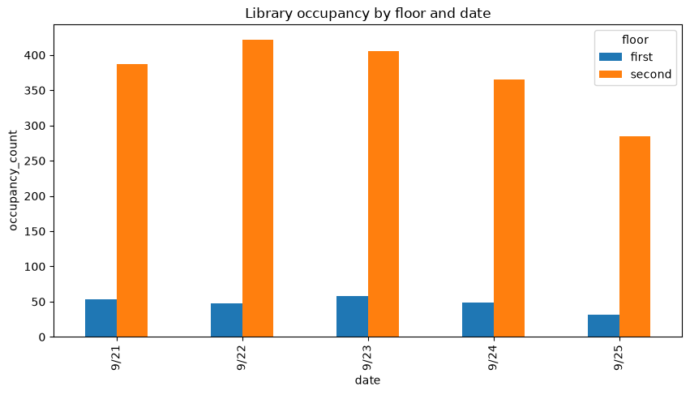
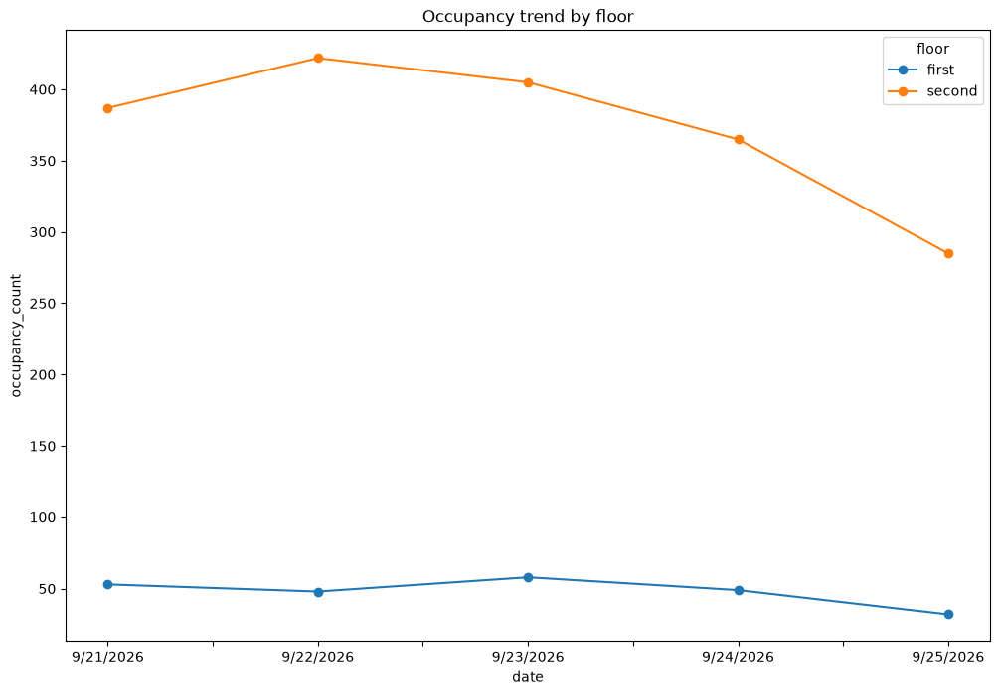
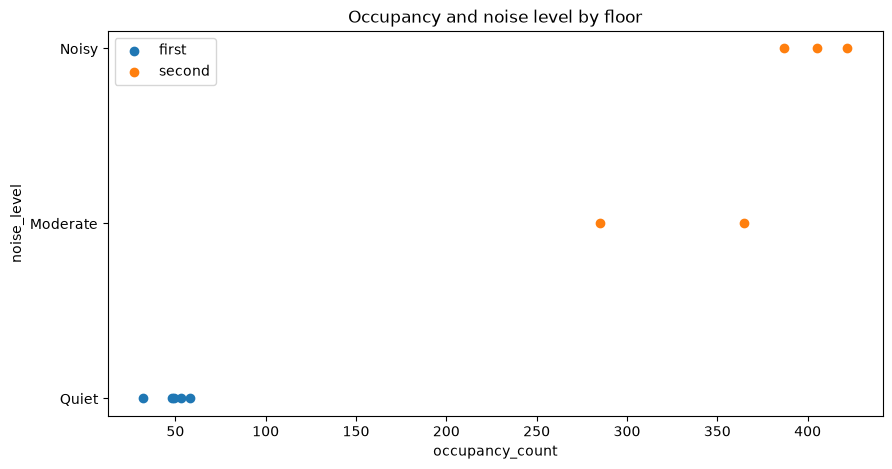
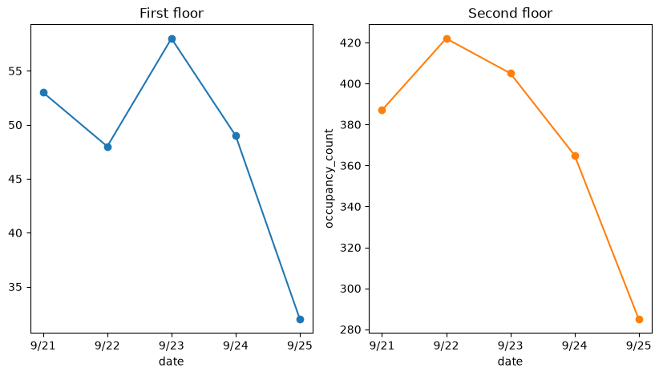
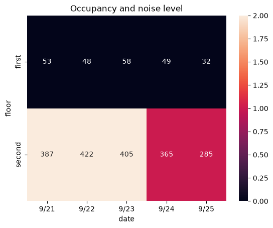
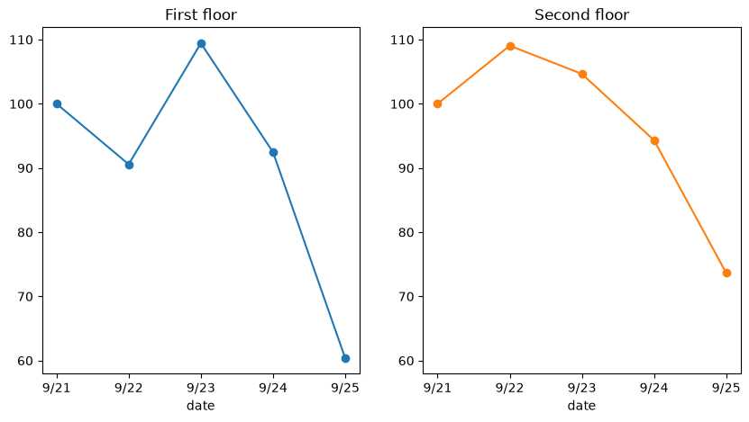
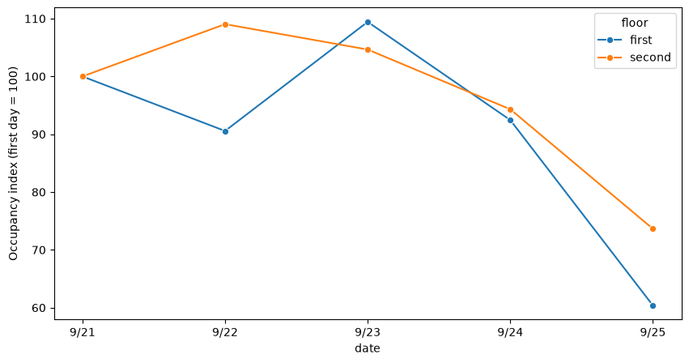

# CS 424 Assignment 2

## Task 1: Revisit Data and Questions

### Data review

- The dataset I use for Assignment 2 is the same as in CS 424 Assignment 1, with 10 observations collected on the first and second floors of the UIC Richard J. Daley Library in a 5-day period at 4 pm. I reviewed the data again and found no problem in the main attributes used for analysis. Some limitations are: a small dataset,approximate rather than exact occupancy counts, and noise levels measured by feelings.

### Questions for Assignment 2

1. What is the occupancy disparity on each day between the two floors?
2. Is there a similar pattern between the occupancy of the two floors?
3. Is there a relation between the noise level and occupancy level for each floor?

- I decided to keep the 1st, 2nd, and 3rd questions but remove the 4th because the small dataset makes it easy to directly identify the day with the highest and lowest numbers of occupants. 

## Task 2: Prepare the Data

- I used pandas to inspect the old dataset to find missing values and duplicate rows. I didn’t find any major errors in the main attributes (used for analysis and visualization).
- Some notes in the grid contained nothing because they were recorded only when something unusual occurred. To avoid representing blank cells as NaN, I replace them with a new value called Normal, indicating that no unusual event was noted for that observation.
- I exported the dataset from Excel to CSV for analysis and visualizations. The process is written in `notebooks/task2_preparation.ipynb`, so the CSV dataset can be generated from the original dataset (Excel). 

## Task 3: Explore the Data

### Occupancy comparison

- The bar chart shows that the second floor had a much higher occupancy count than the first floor on every day. The difference between the two floors was very large throughout the 5-day period, although occupancy on both floors was lowest on Friday.

### Occupancy trend

- Two floors didn’t follow the same pattern during the 5-day period. The second floor reached its highest occupancy on Tuesday, 9/22 and then decreased for the rest of the week, while the first floor reached its highest occupancy on Wednesday, 9/23. Both floors showed a noticeable decrease by Friday, 9/25.

### Occupancy and noise level

- The first floor was recorded as quiet on all 5 days, so there is not enough variation to detect a relationship with occupancy on that floor. On the second floor, higher occupancy observations were recorded as Noisy, and lower occupancy observations were recorded as Moderate. This suggests a possible relationship between higher occupancy and higher perceived noise on the second floor, although the dataset is too small to support a strong conclusion.

## Task 4: Implement visualization alternatives

### Direction 1

- This bar chart compares occupancy between two floors during the period. Three attributes used are date, floor, and occupancy_count. This design already works well for direct comparison, so I decided to keep it. The only problem is the large difference in occupancy between the 2 floors compresses the number on the first floor. 

### Direction 2

- This graph represents the occupancy pattern over time for each floor using date, floor, and occupancy_count with points and lines over the five days. Separating the two floors into separate graphs was necessary due to the discrepancy in occupancy levels. It became easier to interpret both graphs this way, so I will continue working with it. 

### Direction 3

- This heatmap includes date, floor, occupancy_count, and noise_level. Position represents date and floor, color represents noise_level, and numbers represent occupancy_count. I created this visualization to combine occupancy and noise into a single visualization. But a small dataset makes the heatmap not smooth and effective. I decided to keep this as an alternative direction.

## Task 5: Interaction and multiple views

- I considered adding a filter by floor (first or second), but it's not very useful for a small dataset that only has two floors. Moreover, switching between floors via a filter will make the comparison less direct than showing both views side by side. Instead, I used multiple views in the line chart. Separating the two floors makes the pattern within each floor easier to see while still allowing direct visual comparison. For this dataset, static multiple views were more useful than interaction.

## Task 6: Iterate and refine

- I chose the 2nd direction because that is the strongest direction to show how occupancy changes over time for each floor

### Iteration 1: Normalize occupancy

- The original chart from task 3 not fully show the relative change in occupancy over a 5-day period. Using the same scale for both floors compresses the number of first floor because the second floor is much higher. Therefore, I updated it by refining it into 2 charts for each floor in task 4. The visualization is much better for individual floors; however, different occupancy scales make it very difficult to make any comparison between the two floors.
- I converted occupancy_count to occupancy_index, with Monday for each floor set to 100. Both the first and second floors now use the same scale, which is easier for comparison.

### Iteration 2: Combine both floors

- After normalization, both floors could be compared on the same scale. However, the separate panels still required the viewer to manually compare the patterns between the two floors. Therefore, I combined both floors into one line chart while keeping the normalized occupancy index. This makes the trend and characteristic (similarities and differences) between the two patterns easier to see directly. 
- For example, the first floor increased more sharply on Wednesday, 9/23 while both floors decreased toward the end of the week (Friday, 9/25).

## Task 7: Current design

- The visualization I will continue to develop is the occupancy index chart from Task 6’s 2nd iteration. It primarily addresses whether the two floors trend towards similar or different occupancy patterns across the 5-day period.
- The main design decision was to convert occupancy to an index, with the first day set to 100, and to display both floors on the same chart. This allows the relative changes in occupancy to be compared directly, even though the two floors have very different actual occupancy counts.
- Compared with my Assignment 1 sketches and earlier implementations, this design focuses more on relative change between days rather than the absolute occupancy value. Earlier versions either used the same raw scale or separated the floors into different views. The current design places both patterns on one shared scale.
- The design works well for showing the pattern, but I’m not sure whether the normalized occupancy index is easy to understand, and removing the original occupancy counts hides important information.
- In Assignment 3, I will evaluate the ability to understand the normalized index and compare patterns between the two floors. I will find whether the normalized values provide more meaningful insights than the original occupancy values.
