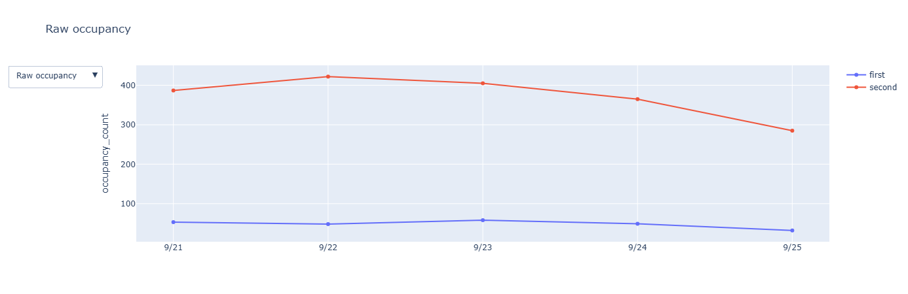

# CS 424 Assignment 3

## Task 1: Implementing Interaction

I selected the line chart from Assignment 2 because it compares occupancy patterns between the first and second floors across the five collection days.

### Static version

The static version shows two views side by side. The first chart shows the original occupancy counts, while the second chart shows the normalized occupancy index where Monday is set to 100. This allows viewers to compare both the actual occupancy difference and the relative pattern between the two floors.

### Interactive version

The interactive version uses the same dataset but combines the two views into one chart. A dropdown allows the viewer to switch between `Raw occupancy` and `Occupancy index`.

The raw occupancy view supports comparing the actual occupancy difference between the two floors. The occupancy index view supports comparing their relative changes over time. I expect the interaction to help users switch between these two analytical perspectives without having to compare two separate charts at the same time.

## Task 2: Evaluation Design

### Evaluation question and hypothesis

- The evaluation question is whether the interactive version helps users analyze absolute occupancy differences and relative occupancy patterns more efficiently than the static version.
- I hypothesize that the interactive version will reduce task completion time while maintaining similar accuracy because users can display only the view needed for the current task.

### Analytical tasks

I designed two analytical tasks. Each task has two comparable variants so participants do not answer the exact same question in both conditions.

#### Task 1: Compare changes in occupancy disparity

- **Task 1A:** Which interval had the larger change in occupancy disparity between the two floors: Monday to Wednesday or Wednesday to Friday?
  - Expected answer: **Wednesday to Friday**
  - Monday disparity: 387 - 53 = 334
  - Wednesday disparity: 405 - 58 = 347
  - Friday disparity: 285 - 32 = 253
  - Monday to Wednesday change: |347 - 334| = 13
  - Wednesday to Friday change: |253 - 347| = 94

- **Task 1B:** Which interval had the larger change in occupancy disparity between the two floors: Monday to Thursday or Tuesday to Friday?
  - Expected answer: **Tuesday to Friday**
  - Monday disparity: 334
  - Thursday disparity: 365 - 49 = 316
  - Tuesday disparity: 422 - 48 = 374
  - Friday disparity: 253
  - Monday to Thursday change: |316 - 334| = 18
  - Tuesday to Friday change: |253 - 374| = 121

#### Task 2: Compare relative occupancy variation

For this task, range means the highest occupancy index minus the lowest occupancy index.

- **Task 2A:** Across Monday, Tuesday, and Wednesday, which floor had the larger range in occupancy index?
  - Expected answer: **First floor**
  - First floor range: about 109.4 - 90.6 = 18.8
  - Second floor range: about 109.0 - 100 = 9.0

- **Task 2B:** Across Monday, Tuesday, and Thursday, which floor had the larger range in occupancy index?
  - Expected answer: **Second floor**
  - First floor range: about 100 - 90.6 = 9.4
  - Second floor range: about 109.0 - 94.3 = 14.7

### Experimental design

The study will use a within-subject design, so every participant will use both the static and interactive versions. Each participant will answer two questions with the static version and two questions with the interactive version.

To reduce learning effects, participants will be divided into two groups:

|Group|First condition|Questions|Second condition|Questions|
|---|---|---|---|---|
|A|Static|Task 1A,Task 2A|Interactive|Task 1B,Task 2B|
|B|Interactive|Task 1A,Task 2A|Static|Task 1B,Task 2B|

Five participants will be assigned to each group. This balances the presentation order and distributes the question variants across both conditions.

### Measurements

For every question, I will record:

- **Accuracy:** whether the participant gives the correct answer.
- **Completion time:** the number of seconds from when the question is presented until the participant gives an answer.

I will also record short observations if a participant appears confused by the occupancy index, has difficulty using the dropdown, or has difficulty deciding which view to use.

### Procedure

Participants will first receive a short explanation of the visualization controls without being shown the answers to any analytical questions. They will then complete the four questions according to their assigned condition order.

Only one condition will be shown at a time. For each question, I will start timing when the participant receives the question and stop timing when they provide their final answer. I will record the answer, whether it is correct, and the completion time in seconds.

Before the main study, I will conduct a pilot with one or two participants to check whether the instructions are clear, the questions have appropriate difficulty, and the timing procedure works correctly.