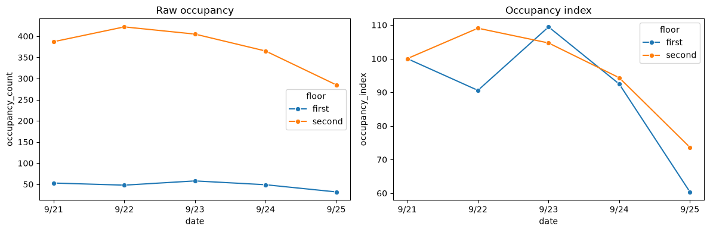
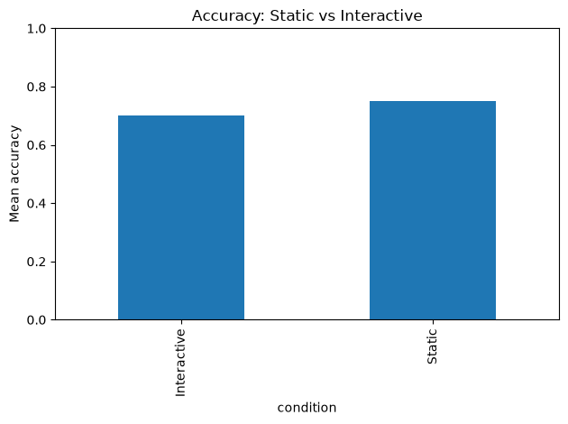
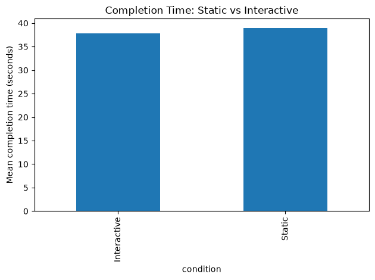

# CS 424 Assignment 3

## Task 1: Implementing Interaction

I selected the line chart from Assignment 2 because it compares occupancy patterns between the first and second floors across the five collection days.

### Static version

The static version shows two views side by side. The first chart shows the original occupancy counts, while the second chart shows the normalized occupancy index where Monday is set to 100. This allows viewers to compare both the actual occupancy difference and the relative pattern between the two floors.

### Interactive version

The interactive visualization is available at
[task1_interactive.html](AS3_figures/task1_interactive.html)

The interactive version uses the same dataset but combines the two views into one chart. A dropdown allows the viewer to switch between `Raw occupancy` and `Occupancy index`.

The raw occupancy view supports comparing the actual occupancy difference between the two floors. The occupancy index view supports comparing their relative changes over time. I expect the interaction to help users switch between these two analytical perspectives without having to compare two separate charts at the same time.

## Task 2: Evaluation Design

### Evaluation question and hypothesis

- The evaluation question is whether the interactive version helps users analyze absolute occupancy differences and relative occupancy patterns more efficiently than the static version.
- I hypothesize that the interactive version will reduce task completion time while maintaining similar accuracy because users can display only the view needed for the current task.

### Analytical tasks

I designed two analytical tasks. Each task has two comparable variants so participants do not answer the exact same question in both conditions.

#### Task 1: Compare changes in occupancy disparity

- **Task 1A:** Which interval had the larger change in occupancy disparity between the two floors: Monday to Wednesday or Wednesday to Friday?
  - Expected answer: **Wednesday to Friday**
  - Monday disparity: 387 - 53 = 334
  - Wednesday disparity: 405 - 58 = 347
  - Friday disparity: 285 - 32 = 253
  - Monday to Wednesday change: |347 - 334| = 13
  - Wednesday to Friday change: |253 - 347| = 94

- **Task 1B:** Which interval had the larger change in occupancy disparity between the two floors: Monday to Thursday or Tuesday to Friday?
  - Expected answer: **Tuesday to Friday**
  - Monday disparity: 334
  - Thursday disparity: 365 - 49 = 316
  - Tuesday disparity: 422 - 48 = 374
  - Friday disparity: 253
  - Monday to Thursday change: |316 - 334| = 18
  - Tuesday to Friday change: |253 - 374| = 121

#### Task 2: Compare relative occupancy variation

For this task, range means the highest occupancy index minus the lowest occupancy index.

- **Task 2A:** Across Monday, Tuesday, and Wednesday, which floor had the larger range in occupancy index?
  - Expected answer: **First floor**
  - First floor range: about 109.4 - 90.6 = 18.8
  - Second floor range: about 109.0 - 100 = 9.0

- **Task 2B:** Across Monday, Tuesday, and Thursday, which floor had the larger range in occupancy index?
  - Expected answer: **Second floor**
  - First floor range: about 100 - 90.6 = 9.4
  - Second floor range: about 109.0 - 94.3 = 14.7

### Experimental design

The study used a within-subject design, so every participant used both the static and interactive versions. Each participant answered two questions with the static version and two questions with the interactive version.

To reduce learning effects, participants were divided into two groups:

|Group|First condition|Questions|Second condition|Questions|
|---|---|---|---|---|
|A|Static|Task 1A,Task 2A|Interactive|Task 1B,Task 2B|
|B|Interactive|Task 1A,Task 2A|Static|Task 1B,Task 2B|

Five participants were assigned to each group. This balanced the presentation order and distributed the question variants across both conditions.

### Measurements

For every question, I recorded:

- **Accuracy:** whether the participant gave the correct answer.
- **Completion time:** the number of seconds required to complete the question.

Correct answers were recorded as 1, while incorrect and No answer responses were recorded as 0.

### Procedure

Participants first received a short explanation of the visualization controls without being shown the answers to any analytical questions. They then completed the four questions according to their assigned condition order.

Participants recorded their own completion time for each question. They started the timer when they began reading the question and stopped it when they gave their final answer. They were asked to answer as quickly as they reasonably could, and they could select No answer if they could not determine an answer.

Before the main study, I conducted a pilot with one participant to check whether the instructions were clear, the questions had appropriate difficulty, and the timing procedure worked correctly.

## Task 3: Conducting the Evaluation

### Pilot evaluation
I conducted a pilot evaluation with one participant before the main study. The participant completed all four questions correctly.

The participant reported that the interactive visualization was easier to view because it displayed one graph at a time, while the static version showed two graphs side by side. The participant also found Task 1 more difficult than Task 2 because Task 1 required more calculation steps.

The completion times were 46 and 19 seconds for the two static questions, and 40 and 15 seconds for the two interactive questions. The participant did not report any problems understanding or using the dropdown.

Based on the pilot, the questions and visualization were understandable, so I kept the revised tasks for the main study.

### Main study
I conducted the main study with 10 participants. Five participants completed the static condition first, while the other five completed the interactive condition first. Each participant answered four questions and recorded their completion time for each question.

### Collected data
I recorded participant ID, group, condition, task, answer, correctness, and completion time. The results are stored in data/AS3_evaluation_result.csv, while the pilot data is stored in data/AS3_Pilot.csv.

## Task 4: Quantitative Analysis

### Overall results

The interactive condition had a mean accuracy of 0.70, a median of 1.0, and a standard deviation of 0.47. The static condition had a mean accuracy of 0.75, a median of 1.0, and a standard deviation of 0.44.

For completion time, the interactive condition had a mean of 37.8 seconds, a median of 35.0 seconds, and a standard deviation of 19.33 seconds. The static condition had a mean of 39.0 seconds, a median of 33.0 seconds, and a standard deviation of 20.56 seconds.

The interactive version was slightly faster on average, while the static version had slightly higher accuracy. The differences between the two conditions were small.

### Accuracy

The static condition had slightly higher overall accuracy than the interactive condition.

Task difficulty had a larger effect on accuracy. Task 1 had an overall accuracy of about 0.50, while Task 2 had an overall accuracy of about 0.95. Task 1 also had more incorrect and No answer responses.

### Completion time

Participants were slightly faster overall with the interactive version, but this was not consistent for every task.

Task 1 took about 52.5 seconds on average, while Task 2 took about 24.4 seconds. This shows that Task 1 required much more time than Task 2.

### Differences across participants

Performance also varied across participants. For example, P01 was faster with the interactive version, while P08 was faster with the static version. This shows that the effect of interaction was not the same for every participant.

### Interpretation

My hypothesis was that the interactive version would reduce completion time while maintaining similar accuracy.

The results provide limited support for this hypothesis. The interactive version was slightly faster overall, but its accuracy was also slightly lower. The results suggest that task difficulty had a larger effect on performance than whether the visualization was static or interactive.

Because the differences between the two conditions were small, I cannot conclude that one version was clearly better than the other.

## Task 5: Reflection and Recommendations

The interactive version was slightly faster overall, but it did not improve accuracy. One strength of the interactive design is that it shows one graph at a time, which reduces visual clutter compared with the two graphs shown side by side in the static version.

However, the interaction did not consistently improve performance. Some participants were faster with the interactive version, while others were faster with the static version. Task 1 was also much more difficult and time-consuming than Task 2.

If I improved the visualization, I would make the exact occupancy values easier to read, such as by adding clearer value labels or details-on-demand. This could reduce the amount of calculation needed for the disparity questions.

There are several limitations in this evaluation. The study only included 10 participants, and participant background was not controlled, so differences in visualization experience may have affected performance. Task 1 and Task 2 also had different difficulty levels. Participants recorded their own completion times, which may have caused small differences in timing. Learning effects may also have affected the results because every participant used both versions.

Overall, the interactive version provided a cleaner way to switch between the two views, but the evaluation did not show a clear performance advantage over the static version.